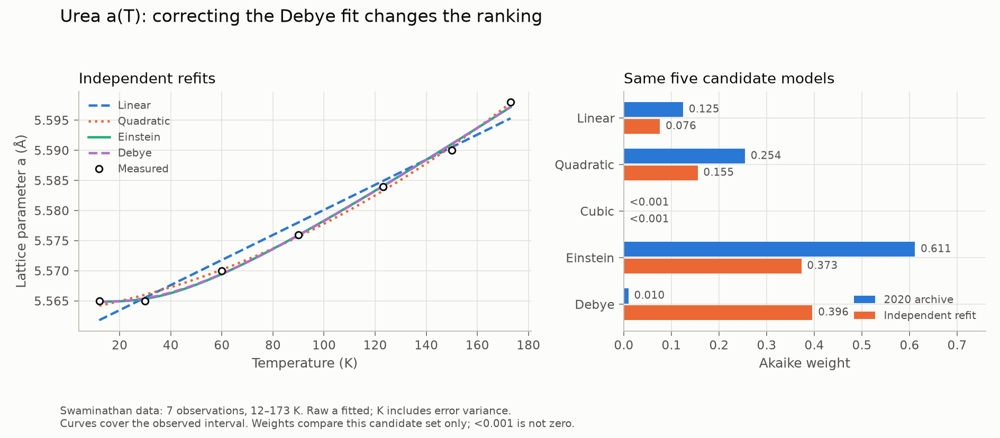
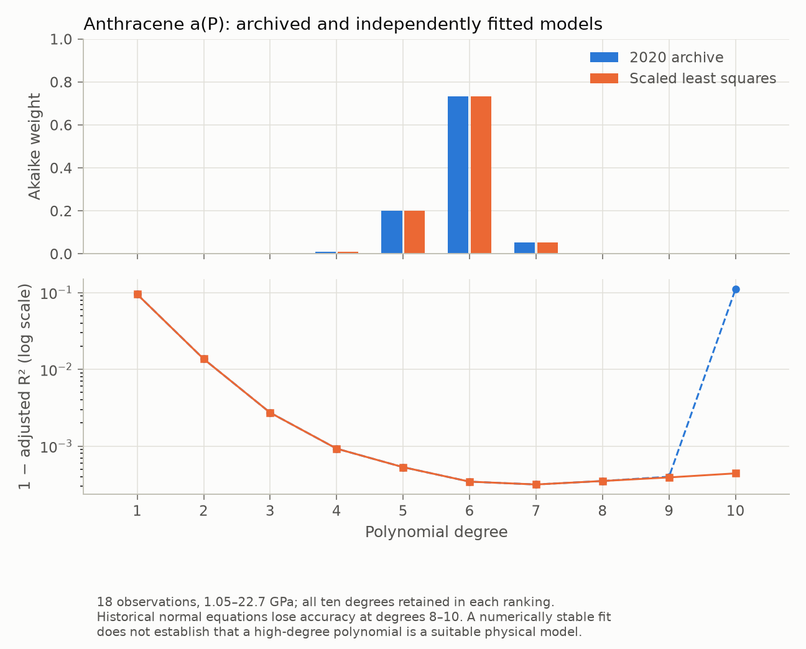

# Akaike-weight model selection for crystal lattice-parameter data

Undergraduate research code (MATLAB, 2020) that fits competing models to how a
crystal's lattice parameters change with temperature or pressure, then ranks the
models with information theory (AICc, Akaike weights, evidence ratios) instead of
R² or adjusted R².

> Undergraduate research with Prof. Peter Moeck (Nano-Crystallography Group,
> Portland State University). It began as a project in his Materials Physics course
> in spring 2019 and continued in the group through 2020; the code dates from
> March–November 2020. Archived to GitHub in
> 2026. The MATLAB code and the result files are unchanged from 2020. This README,
> `data/README.md`, the figures in `docs/img/` and the Python scripts in
> `docs/scripts/` were written in 2026.

<picture>
  <source media="(prefers-color-scheme: dark)" srcset="docs/img/urea_a_dark.png">
  
</picture>

## Motivation

Thermal expansion coefficients in the crystallography literature are usually taken
from a polynomial fit to lattice parameters measured at a handful of temperatures.
Authors pick the polynomial degree by eye or by R², and published coefficients for
the same material can disagree. The aim of this project was to show, on real
published data, what the information-theoretic approach to model selection offers
instead. That approach, popularized by Burnham and Anderson, rewards goodness of fit
but charges for each extra parameter. It also gives a relative weight of evidence
for each candidate model, rather than a single "best" one.

## What the code does

For one dependent variable (e.g. lattice parameter *a*) against one independent
variable (temperature or pressure), the pipeline:

1. fits polynomials of degree 1 … *p* by ordinary least squares, with parameter
   standard errors, R² and adjusted R²;
2. fits two physically motivated nonlinear models by Levenberg–Marquardt (`lsqnonlin`):
   * an **Einstein-type** model, $a(T) = a_0 + \dfrac{x}{e^{\theta_E/T} - 1}$;
   * a **Debye-type** model, $a(T) = a_0 + x\,T\,R(\theta/T)$, where $R$ is a published
     rational approximation to the Debye function (coefficients hard-coded in
     `nonlinear_least_squares.m`);
3. computes, for every model,
   * the small-sample corrected Akaike criterion
     $\mathrm{AICc} = n\ln(\mathrm{RSS}/n) + \dfrac{2Kn}{n-K-1}$, where $K$ counts the
     fitted parameters plus the error variance,
   * Akaike weights $w_i = e^{-\Delta_i/2} / \sum_j e^{-\Delta_j/2}$, with
     $\Delta_i = \mathrm{AICc}_i - \min_j \mathrm{AICc}_j$,
   * the matrix of evidence ratios $w_i / w_j$;
4. writes everything to spreadsheets (`degree_k.xls`, `nonlinear.xls`, `AIC.xls`).

## Repository layout

```
src/        final modular version of the pipeline (Nov 2020)
  workflow.m                  entry point
  input_data.m                load data (arguments or interactive prompts)
  ordinary_least_squares.m    polynomial fits, standard errors, R², adjusted R²
  nonlinear_least_squares.m   Einstein and Debye fits
  AICc_calc.m                 AICc, Akaike weights, evidence ratios
  output_data.m               spreadsheet output
legacy/     earlier single-script versions (8 Apr 2020: polynomials only;
            1 Jul 2020: adds Einstein/Debye fits)
data/       the three datasets used; see data/README.md for sources and layout
results/    original 2020 output
  2020-04_polynomial/          polynomial-only runs (Apr 2020 script) for every dataset
  2020-11_modular_swaminathan/ full run of src/ on urea, lattice parameter a
docs/img/      README figures (2026)
docs/scripts/  Python re-computation and plotting scripts (2026)
```

## Usage

Written for MATLAB R2020b. Needs the Optimization Toolbox (`lsqnonlin`) and the
Symbolic Math Toolbox (`syms`/`fplot`, used for the diagnostic plots).

```matlab
cd src
% workflow(file, layout, xIndex, yIndex, maxDegree)
% layout: 0 = variables stored in rows, 1 = variables stored in columns
workflow('../data/swaminathan.txt', 0, 1, 2, 3)   % urea, a(T), degrees 1-3
workflow('../data/julian.txt',      1, 1, 3, 3)   % urea, c(T)
workflow()                                         % interactive: file picker + prompts
```

The output spreadsheets go to the current folder.

I did not re-run the MATLAB code when archiving it in 2026, because I no longer had
MATLAB. Instead, `docs/scripts/verify.py` re-computes the 2020 numbers independently
with NumPy/SciPy. The audit reads all 65 archived `.xls` files and checks 52 polynomial fits across
all eight data series, plus the modular polynomial and nonlinear fits. Stored
coefficients reproduce stored AICc within an absolute tolerance of 10⁻⁷.
Independent scaled polynomial fits agree within 10⁻⁷ through degree 6, 10⁻⁵ at
degree 7, and 10⁻² at degree 8. Degrees 9–10 are reported as numerical discrepancies;
the independent fits improve their residual sums of squares. The Einstein refit
agrees within 10⁻⁴ AICc. See the [full numerical audit](docs/generated/polynomial_audit.csv).

## Results (2020 runs)

**Urea, low temperature** (Swaminathan et al.; 7 points, 12–173 K). For *a*, the
3-parameter Einstein model carries most of the weight (0.61), then the quadratic
(0.25) and the linear model (0.12). The cubic gets essentially zero weight. With
only seven points, its two extra parameters cost more in AICc than they buy in fit.
For *c*, the linear model takes almost all of the weight (polynomial-only run:
0.999).

**Urea, near room temperature** (Hammond et al., as tabulated in Julian's textbook;
15 points, 188–328 K). For *a*, the data barely discriminate: linear 0.41, cubic
0.35, quadratic 0.24. For *c*, linear is preferred (0.77).

**Anthracene under pressure** (Oehzelt et al.; 18 points, 1–22.7 GPa, polynomial
degrees 1–10). The Akaike weights concentrate on one or two degrees: degree 6 for
*a* (0.73) and *c* (0.95), degree 5 for *b* (0.80), and degree 3 for the monoclinic
angle β (0.80). Adjusted R², by contrast, creeps upward to degree 7 by amounts in
the fourth decimal place and gives no clear stopping point:

<picture>
  <source media="(prefers-color-scheme: dark)" srcset="docs/img/anthracene_a_dark.png">
  
</picture>

**What we concluded at the time.** A cubic fit to the Hammond data for *a* can score
well, but it extrapolates to a 0 K lattice parameter far above what the
low-temperature measurements show, so it is not physical. We put this down to the
lower accuracy of the Hammond data compared with the Swaminathan data. The
Swaminathan *a* data are clearly non-linear at low temperature. An Einstein fit
extrapolated toward the melting point of urea (roughly 400 K) suggested where
thermal expansion would level off.

## Limitations

* **Very small samples.** Seven points (Swaminathan) is about as few as AICc can
  handle. For the cubic, *K* = 5, so the AICc penalty term is 2·5·7 / (7 − 5 − 1) = 70.
  Its weight of zero mostly reflects that penalty, not evidence against curvature.
* **Data quality.** The Hammond *a* data contain a jump. The Hammond paper reports
  no polymorphic transformation over 188–328 K, so the jump is measurement scatter,
  and it weakens any model comparison on that dataset.
* **Fits across both temperature ranges.** The Hammond result says nothing about
  the gap between the low-temperature data (≤ 173 K) and the high-temperature data
  (≥ 188 K). Our December 2020 draft raised a possible phase transition there, citing
  anisotropic peak broadening reported by Birkedal et al. A fit to the combined data,
  where the cubic took nearly all the weight, may therefore be fitting through a
  transition. We never resolved this.
* **Model forms.** The Einstein and Debye models are heat-capacity forms borrowed
  for thermal expansion. They are useful for interpolation and for the
  high-temperature limit, not as a physical model of a molecular crystal like urea.

## Known issues

I noticed these again while archiving the code in 2026. The code shows I was aware
of most of them in 2020, but much of my reasoning and the follow-up has been lost to
time. The 2020 code and output are left as they were.

* **Plot axes.** The plotting code exponentiates `y`. The write-up fitted ln *a*
  rather than *a*, because the expansion coefficient is α = ∂(ln *a*)/∂*T*, and the
  exponential converts back to Å. The saved runs in `results/2020-04_polynomial/`
  were fed raw lattice parameters, though, so their `figure.pdf` files show exp(*a*)
  under an Å label. Because *a* varies by only about 1% over each dataset, fitting ln *a* instead of
  *a* shifts every AICc by nearly the same amount and leaves the Akaike weights almost
  unchanged. For example, the
  write-up's weights for Hammond *a* match the table above. The README figures plot
  the lattice parameter directly.
* **Debye fit stopped early.** In the 2020 run the optimizer stopped with the
  temperature parameter still at its initial guess (280 K). A 2026 SciPy refit
  converges to about 185 K from four tested starts (80, 150, 280 and 500 K), with AICc −76.77. That essentially ties
  the Einstein model (−76.65), so the 2020 Debye weight (0.01) understates it. The
  likely cause is stopping tolerances combined with badly scaled parameters. The
  tighter tolerances are present but commented out in `nonlinear_least_squares.m`.
* **High-degree anthracene fits.** The archived normal equations lose accuracy:
  AICc differs by up to 0.007 at degree 8 and much more at degrees 9–10. Scaled
  least squares resolves the numerical problem. Model suitability with only
  18 observations remains a separate question; all ten candidates are retained
  in the comparison figure and its weight normalization.
* **Hard-coded starting values.** The nonlinear initial guess in `input_data.m` is
  tuned for urea *a*. Other datasets need their own.
* **Placeholder column.** The `Std_Dev` column in `AIC.xls` is a placeholder
  (always 0).

## Independent refit and reproduction

The corrected Debye fit changes the five-model ranking for Swaminathan *a*.
Debye and Einstein have nearly equal support; their small weight difference does
not justify a strong preference. These weights use raw lattice parameters, the
same seven observations, and the same five candidates in both columns.

| Model | 2020 AICc | 2020 weight | Refit AICc | Refit weight |
|---|---:|---:|---:|---:|
| Polynomial 1 | -73.47 | 0.125 | -73.47 | 0.076 |
| Polynomial 2 | -74.90 | 0.254 | -74.90 | 0.155 |
| Polynomial 3 | -34.25 | <0.001 | -34.25 | <0.001 |
| Einstein | -76.65 | 0.611 | -76.65 | 0.373 |
| Debye | -68.36 | 0.010 | -76.77 | 0.396 |

Values come from [the generated ranking table](docs/generated/urea_rankings.csv).
The figure at the top compares both rankings and shows the independent fits.

To reproduce the audit, tables, and light/dark PNG and vector PDF figures, use
Python 3.12 or later from the repository root:

```sh
python -m venv .venv
.venv/bin/python -m pip install -r requirements-reproduce.txt
MPLCONFIGDIR=.cache/matplotlib .venv/bin/python docs/scripts/verify.py
MPLCONFIGDIR=.cache/matplotlib .venv/bin/python docs/scripts/plots.py
```

The tested dependency versions are pinned in `requirements-reproduce.txt`.
`docs/generated/audit.json` records the actual Python/library versions and SHA-256
hashes of all data and spreadsheets. Figures read that canonical result and reject
changed inputs until verification is rerun. Polynomial fits use a scaled basis;
nonlinear fits require positive amplitude and characteristic temperature, with
four starting temperatures and explicit convergence tolerances. This is a numerical
cross-check, not a rerun of MATLAB or a proof of global optimization.

PDF figures: [urea](docs/img/urea_a_light.pdf),
[anthracene](docs/img/anthracene_a_light.pdf).

## Status

We drafted a co-authored write-up for arXiv in December 2020. It is an
introduction to information-theoretic model selection for physical scientists,
worked through the urea data. It also tests rounded data, a version with the
288 K and 298 K points swapped, and the combined datasets. I began a solo rewrite in
April 2021 but stopped after the theory sections. Neither version was submitted. I
judged the work to be mainly pedagogical (applying a well-established method to
small published datasets) rather than a novel contribution, and around then I moved
from physics to pure mathematics.

## Sources

Data (details in [`data/README.md`](data/README.md)):

* S. Swaminathan, B. M. Craven et al., neutron-diffraction study of the crystal
  structure and thermal motion of urea, *Acta Crystallographica B* (1984). The
  structures are also in the Crystallography Open Database, e.g.
  [COD 9017316](https://www.crystallography.net/cod/9017316.html).
* R. Hammond, K. Pencheva, K. J. Roberts, P. Mougin, D. Wilkinson, "An examination
  of the thermal expansion of urea using high-resolution variable-temperature X-ray
  powder diffraction", *Journal of Applied Crystallography* (2005), laboratory notes,
  [journals.iucr.org/j/issues/2005/06/00/ko5017](https://journals.iucr.org/j/issues/2005/06/00/ko5017/index.html).
  Taken from the tabulation in M. M. Julian, *Foundations of Crystallography with
  Computer Applications*.
* M. Oehzelt et al., X-ray diffraction studies of anthracene under high pressure
  (Graz University of Technology).

Methods and tools:

* AICc, Akaike weights and evidence ratios follow D. R. Anderson, *Model Based
  Inference in the Life Sciences: A Primer on Evidence*, and K. P. Burnham and
  D. R. Anderson, *Model Selection and Multimodel Inference*.
* The rational approximation to the Debye function is credited in the code to
  H. C. Thacher, "Rational Approximations for the Debye Functions".
* T. Langreiter and V. Kahlenberg, "TEV—A Program for the Determination of the
  Thermal Expansion Tensor from Diffraction Data", *Crystals* 5, 143–153 (2015),
  [mdpi.com/2073-4352/5/1/143](https://www.mdpi.com/2073-4352/5/1/143). Used as a
  reference implementation for polynomial fits.

The data in `data/` are taken from the publications above. Please cite those, not
this repository.
